  

  
  
  
  
  
  

---

# 📸 Awesome Photo & Video Management

> 🌐 **A curated directory of top-tier SaaS platforms and open-source self-hosted solutions for managing, organizing, backing up, and searching personal & professional photo and video libraries.**

Whether you are looking for an open-source, privacy-first **Google Photos alternative** with local AI facial recognition (like **Immich** or **PhotoPrism**), end-to-end encrypted backup (like **Ente**), or comparing commercial cloud storage ecosystems (like **Apple iCloud**, **Google One**, and **Adobe Lightroom**), this guide delivers deep technical comparisons, transparent pricing breakdowns, and architecture trade-offs.

---

## 📑 Table of Contents

- [📊 Sector Overview & Market Dynamics](#-sector-overview--market-dynamics)
- [☁️ SaaS & Hosted Platforms](#️-saas--hosted-platforms)
- [🚀 Open-Source GitHub Projects](#-open-source-github-projects)
- [⚖️ Architectural & Feature Comparison](#️-architectural--feature-comparison)
- [🛡️ Self-Hosting Best Practices & Backup Rules](#️-self-hosting-best-practices--backup-rules)
- [🤝 How to Contribute](#-how-to-contribute)
- [⭐ Star History](#-star-history)
- [💖 Support & Sponsoring](#-support--sponsoring)
- [📜 Disclaimer](#-disclaimer)

---

## 📊 Sector Overview & Market Dynamics

The global personal and prosumer digital asset / photo-video management market is estimated at **$5.4 billion in 2026** and projected to surpass **$11.8 billion by 2031** (growing at a compound annual growth rate of ~16.8%), propelled by exponential 4K/8K smartphone media capture, RAW computational photography, and breakthroughs in local multimodal neural models (CLIP vector search and facial embeddings).

The market structure exhibits a profound duality:
- **Consumer Cloud Storage is Highly Concentrated (Winner-Take-All)**: Operating system giants **Apple** (iCloud Photos) and **Alphabet** (Google Photos) dominate mobile capture workflows with over 80% combined global market capture via pre-installed system-level camera sync, massive data lock-in, and cross-subsidized subscription bundles (Apple One, Google One).
- **Self-Hosted & Privacy-First Media is Highly Fragmented & Rapidly Accelerating**: Increasing consumer backlash against unannounced cloud compression, subscription price increases, privacy violations, and unauthorized AI model training on personal memories has ignited a booming counter-market of self-hosted, sovereign, and zero-knowledge solutions (led by **Immich**, **PhotoPrism**, and **Ente**).

---

## ☁️ SaaS & Hosted Platforms

Below is a detailed comparison of the primary commercial hosted photo and video management platforms, **sorted in descending order by company valuation / annual revenue**:

| 🏷️ Platform & Provider | 🏢 Company Scale (Valuation / Revenue) | 💳 Specific Starting Tier Pricing | 🎁 Specific Free Tier / Trial Limit | 🌟 Core Strengths & Capabilities | ⚠️ Key Trade-offs & Limitations |
| :--- | :--- | :--- | :--- | :--- | :--- |
| **[Apple iCloud Photos](https://www.icloud.com/photos)** *(Apple Inc.)* | **~$3.5 Trillion Valuation** ~$391B Annual Revenue | **$0.99 / month** for 50 GB (*iCloud+*); $2.99 / mo for 200 GB; $9.99 / mo for 2 TB | **5 GB lifetime free storage** per Apple ID (shared across Photos, iCloud Drive, Mail, and Device Backups) | Native frictionless capture-to-cloud sync across iPhone, iPad, and Mac; shared iCloud Photo Library for families; on-device neural curation | Strict ecosystem lock-in; poor Windows integration; stripped web interface; zero official APIs for programmatic export or third-party backup |
| **[Google Photos](https://photos.google.com/)** *(Alphabet Inc.)* | **~$2.2 Trillion Valuation** ~$307B Annual Revenue | **$1.99 / month** ($19.99 / year) for 100 GB (*Google One Basic*); $2.99 / mo for 200 GB; $9.99 / mo for 2 TB | **15 GB lifetime free storage** shared across Google Photos, Drive, and Gmail | Industry benchmark for automated face clustering, natural-language semantic search, automated album generation, and cross-platform sync | Lossy "Storage Saver" compression unless paying for original quality; user data subject to cloud telemetry; Google Takeout export is slow and strips album structures |
| **[Amazon Photos](https://www.amazon.com/photos)** *(Amazon.com Inc.)* | **~$2.1 Trillion Valuation** ~$574B Annual Revenue | **$1.99 / month** for 100 GB standalone storage addon; or included with Prime (**$14.99 / mo** / $139 / yr) | **5 GB combined lifetime storage** for non-Prime users; Prime members get **Unlimited full-res photos + 5 GB video** | Unlimited RAW and original-resolution photo backup for Amazon Prime members; automated fire TV screensaver integrations | Video storage is capped tightly at 5 GB without expensive addons; mobile app UI and search indexing significantly lag behind Google Photos |
| **[Adobe Lightroom](https://lightroom.adobe.com/)** *(Adobe Inc.)* | **~$220 Billion Valuation** ~$21.4B Annual Revenue | **$9.99 / month** ($119.88 / year) for Lightroom Plan (includes **1 TB cloud storage**) | **7-day fully functional free trial** with 1 TB cloud sync (no permanent free storage plan) | Gold standard for professional RAW digital asset management, non-destructive editing, parametric adjustments, and multi-device catalog synchronization | Cost prohibitive for general consumer backup; requires active continuous subscription to maintain cloud editing synchronization |
| **[Dropbox Photos](https://www.dropbox.com/)** *(Dropbox, Inc.)* | **~$9.2 Billion Valuation** ~$2.5B Annual Revenue | **$9.99 / month** ($119.88 / year) for Dropbox Plus (includes **2 TB cloud storage**) | **2 GB lifetime free storage** (Dropbox Basic plan with automated Camera Uploads enabled) | Excellent cross-platform desktop filesystem sync; fast automated camera roll upload; robust version history and file restoration | Not a dedicated photo gallery (lacks native face grouping and AI scene recognition); free tier limit is severely restrictive for modern media |
| **[Flickr](https://www.flickr.com/)** *(SmugMug, Inc.)* | **~$80 Million Est. Revenue** (Privately Held) | **$8.49 / month** ($71.88 / year billed annually at $5.99/mo) for *Flickr Pro* | **Free forever plan limited to 1,000 photos and videos** max (up to 200 MB per photo, 1 GB per video) | Thriving photography community; rich EXIF metadata preservation; public and private album showcase; uncompressed original hosting | Focused on photo showcase rather than automated mobile device backup; heavy advertising on free accounts |
| **[Mylio Photos](https://www.mylio.com/)** *(Mylio, LLC)* | **~$20 Million Est. Revenue** (Privately Held) | **$9.99 / month** ($99.00 / year) for *Mylio Photos+* (includes encrypted cloud/NAS sync & Spaces) | **Free forever plan** for unlimited photos across up to **3 local devices** (local P2P sync and organizing only) | Local-first architecture; photos stay on physical drives; peer-to-peer device sync over local Wi-Fi without third-party cloud dependence | Complex initial setup; steep learning curve; multi-device off-site backup requires user-provided external storage or paid cloud bridge |

---

## 🚀 Open-Source GitHub Projects

Explore the most active, community-trusted open-source photo and video management platforms, **ranked strictly by GitHub stargazers count (descending)**:

### 1. 🥇 [Immich](https://github.com/immich-app/immich) 
- **Primary Focus**: The premier self-hosted Google Photos replacement with mobile-first automatic background backup.
- **Key Features**: Seamless iOS and Android native apps, timeline scrubbing, on-device/local facial recognition, CLIP semantic image vector search, reverse geocoding interactive maps, partner library sharing, and multi-user permissions.
- **Tech Stack & Deployment**: TypeScript, Dart (Flutter), NestJS, SvelteKit, PostgreSQL with `pgvector`, Redis, machine-learning microservice. Deployed via Docker Compose (6+ containers).
- **Hardware Footprint**: Requires a minimum of 4 GB RAM (8 GB+ recommended, especially during initial neural embedding generation). GPU acceleration (CUDA/OpenVINO) supported.
- **License**: AGPL-3.0

### 2. 🥈 [PhotoPrism](https://github.com/photoprism/photoprism) 
- **Primary Focus**: High-performance, AI-powered media library management tailored for photographers and existing archives.
- **Key Features**: In-depth metadata parsing (Exif, XMP, IPTC), extensive RAW conversion (Darktable/RawTherapee sidecars), color palettes, facial clustering, automated classification, and world map visualization.
- **Tech Stack & Deployment**: Go, Vue.js, TensorFlow, MariaDB/MySQL. Deployed via Docker Compose (2 containers: app + database).
- **Hardware Footprint**: Lightweight compared to competitors: runs on 1 GB–2 GB RAM for base operations; 4 GB recommended for concurrent indexing.
- **License**: AGPL-3.0

### 3. 🥉 [Ente](https://github.com/ente-io/ente) 
- **Primary Focus**: End-to-end encrypted (E2EE), zero-knowledge cloud alternative to Apple and Google Photos.
- **Key Features**: Complete client-side cryptographic encryption where keys never leave client devices, automated background camera backup on iOS/Android, family sharing, desktop apps, web client, and self-hostable backend.
- **Tech Stack & Deployment**: Go backend, Flutter (iOS, Android, Desktop), React (Web).
- **Hardware Footprint**: Self-hostable on minimal cloud VPS instances using S3-compatible object storage backends.
- **License**: AGPL-3.0

### 4. 🏅 [LibrePhotos](https://github.com/LibrePhotos/librephotos) 
- **Primary Focus**: AI-driven photo discovery engine scanning existing disk directory structures directly.
- **Key Features**: Scans folders non-destructively; deep local AI featuring ArcFace/InsightFace facial detection, SigLIP 2 zero-shot tagging, perceptual hashing duplicate detection, smart semantic search, and auto-generated timeline stories.
- **Tech Stack & Deployment**: Python (Django), React, PostgreSQL, Redis. Deployed via Docker Compose.
- **Hardware Footprint**: Moderate-to-heavy (6 GB–8 GB RAM suggested for intensive AI indexing passes).
- **License**: MIT

### 5. 📷 [Photoview](https://github.com/photoview/photoview) 
- **Primary Focus**: Ultra-lightweight, fast self-hosted photo gallery engineered for low-resource personal servers and NAS devices.
- **Key Features**: Non-destructive read-only scanning of local directories, multi-user support with folder isolation, high-speed thumbnail pre-caching, EXIF metadata viewer, RAW format support, and basic face recognition.
- **Tech Stack & Deployment**: Go backend, Vue.js frontend, MariaDB/MySQL/PostgreSQL. Simple 2-container Docker Compose.
- **Hardware Footprint**: Extremely light (runs smoothly on Raspberry Pi with 512 MB–1 GB RAM).
- **License**: AGPL-3.0

### 6. 🖼️ [Lychee](https://github.com/LycheeOrg/Lychee) 
- **Primary Focus**: Elegant, modern, and clean web photo management and presentation system.
- **Key Features**: Beautiful responsive interface, public and password-protected album sharing, full-screen slideshows, EXIF/IPTC inspector, tag-based organization, and direct Dropbox/server import.
- **Tech Stack & Deployment**: PHP (Laravel framework), Livewire / Blade, MySQL/PostgreSQL/SQLite.
- **Hardware Footprint**: Low memory footprint; compatible with standard shared LAMP/LEMP hosting stacks and Docker.
- **License**: MIT

### 7. 🗃️ [Piwigo](https://github.com/Piwigo/Piwigo) 
- **Primary Focus**: Mature, enterprise-grade open-source photo gallery software with an extensive plugin ecosystem.
- **Key Features**: Over 200 plugins and themes, hierarchical album trees, batch metadata manager, multi-user permissions, mobile apps (iOS & Android), smart privacy controls, and API integrations.
- **Tech Stack & Deployment**: PHP, MySQL/MariaDB. Deployed via Docker or standard PHP server.
- **Hardware Footprint**: Low memory consumption (512 MB RAM minimum).
- **License**: GPL-2.0

### 8. 🧠 [Nextcloud Memories](https://github.com/pulsejet/memories) 
- **Primary Focus**: High-speed, feature-packed photo management suite operating natively inside an existing Nextcloud deployment.
- **Key Features**: Instant timeline scrubbing over hundreds of thousands of images, hardware-accelerated video transcoding, facial recognition, reverse geocoding map view, and collaborative sharing integrated with Nextcloud files.
- **Tech Stack & Deployment**: PHP, Vue.js, Go (go-vod transcoding daemon), integrated into Nextcloud.
- **Hardware Footprint**: Relies on host Nextcloud server resources; minimal incremental RAM overhead.
- **License**: AGPL-3.0

### 9. 📱 [Fossify Gallery](https://github.com/FossifyOrg/Gallery) 
- **Primary Focus**: Offline-first, privacy-respecting Android photo and video gallery (the community continuation of Simple Gallery).
- **Key Features**: Zero internet permissions required, built-in photo editor, file recycling bin, fingerprint/PIN app locking, advanced sorting and filtering, and smooth 120 Hz display rendering.
- **Tech Stack & Deployment**: Kotlin, Android SDK. Native APK distributed on F-Droid, GitHub Releases, and Google Play.
- **Hardware Footprint**: On-device Android application; negligible resource use.
- **License**: GPL-3.0

### 10. 🎨 [ReFra](https://github.com/IacobIonut01/ReFra) 
- **Primary Focus**: Modern Android media gallery and organizer built with modern Jetpack Compose.
- **Key Features**: Beautiful Material You dynamic theming, smooth album grid animations, on-device media categorization, privacy-centric design without tracking, and built-in image enhancement tools.
- **Tech Stack & Deployment**: Kotlin, Jetpack Compose, Android Architecture Components.
- **Hardware Footprint**: Runs client-side on Android 8.0+.
- **License**: Apache-2.0

### 11. ⚡ [PiGallery 2](https://github.com/bpatrik/pigallery2) 
- **Primary Focus**: Directory-first, lightning-fast photo gallery optimized specifically for low-resource single-board computers (Raspberry Pi).
- **Key Features**: Reads existing folder hierarchies directly without re-organizing disks, on-the-fly client-side thumbnail generation, fast search syntax, video playback, and GPS map clustering.
- **Tech Stack & Deployment**: TypeScript, Node.js, Angular, SQLite. Deployed via Docker.
- **Hardware Footprint**: Extremely efficient; runs on 256 MB–512 MB RAM on Raspberry Pi 3/4/5.
- **License**: MIT

### 12. 🔍 [Damselfly](https://github.com/Webreaper/Damselfly) 
- **Primary Focus**: Server-based photograph organizer focused on rapid indexing and IPTC keyword metadata search across massive photo archives.
- **Key Features**: Ultra-fast search across 500,000+ photo collections, object detection and face recognition using ONNX models, keyword management, sidecar handling, and folder-tree navigation.
- **Tech Stack & Deployment**: C# (.NET 8), Blazor, SQLite/PostgreSQL. Deployed via Docker.
- **Hardware Footprint**: 2 GB–4 GB RAM recommended for large libraries during ONNX model inference.
- **License**: GPL-3.0

### 13. 🤖 [Elodie](https://github.com/jmathai/elodie) 
- **Primary Focus**: Smart EXIF-based photo assistant and command-line automated organizer.
- **Key Features**: Ingests messy camera dumps and reorganizes them into deterministic, human-readable directory structures (`YYYY-MM-DD/Location/Filename.ext`) using EXIF GPS and timestamp metadata.
- **Tech Stack & Deployment**: Python, ExifTool. CLI utility.
- **Hardware Footprint**: Minimal CLI resource consumption.
- **License**: Apache-2.0

### 14. 🌐 [Chevereto](https://github.com/chevereto/chevereto) 
- **Primary Focus**: Mature self-hosted multi-user media and image sharing platform (your own private Flickr / Imgur).
- **Key Features**: Multi-user accounts, drag-and-drop upload, embed code generators for forums/blogs, social sharing controls, album privacy levels, and comprehensive admin dashboard.
- **Tech Stack & Deployment**: PHP, MySQL/MariaDB, Docker.
- **Hardware Footprint**: 1 GB RAM for Docker container deployment.
- **License**: AGPL-3.0

### 15. 📦 [thumbsup](https://github.com/thumbsup/thumbsup) 
- **Primary Focus**: Command-line generator for static HTML photo and video web galleries.
- **Key Features**: Compiles folders of photos and videos into a static HTML/CSS/JS website ready for hosting on GitHub Pages, Netlify, Cloudflare Pages, or AWS S3; supports multiple responsive gallery themes.
- **Tech Stack & Deployment**: Node.js, Handlebars, FFmpeg, Sharp.
- **Hardware Footprint**: Temporary CPU during build; output files require zero server compute.
- **License**: MIT

### 16. 🏛️ [PhotoStructure](https://github.com/photostructure/photostructure-for-servers) 
- **Primary Focus**: Self-hosted digital library consolidator and deduplication engine for fragmented family archives.
- **Key Features**: Bit-level exact and perceptual duplicate detection, aggregates media scattered across old hard drives/phones into a unified timeline, non-destructive file preservation, and cross-platform desktop/server support.
- **Tech Stack & Deployment**: TypeScript, Node.js, SQLite. Deployed as desktop app or Docker container.
- **Hardware Footprint**: 2 GB–4 GB RAM during initial archive ingestion and hash deduplication.
- **License**: Source-available / Proprietary Core with open container packaging

---

## ⚖️ Architectural & Feature Comparison

| Solution | Primary Architecture | Automatic Phone Backup | Facial Recognition | Semantic AI Search | Minimum RAM | Host System Impact |
| :--- | :--- | :---: | :---: | :---: | :---: | :--- |
| **Immich** | Microservices + Postgres + Redis | ✅ Native (iOS & Android) | ✅ On-device / Local ML | ✅ Local CLIP Embeddings | 4–8 GB | High (Microservices cluster) |
| **PhotoPrism** | Monolith + MariaDB | ⚠️ Companion (PhotoSync/WebDAV) | ✅ TensorFlow | ⚠️ Keyword & Filter | 1–2 GB | Moderate (Compact) |
| **Ente** | Encrypted Cloud / S3 Backend | ✅ Native (iOS & Android) | ⚠️ Client-side basic | ❌ E2EE Encrypted | 512 MB–1 GB | Low (Client does heavy lifting) |
| **LibrePhotos** | Django + React + Redis | ⚠️ WebDAV / OwnCloud sync | ✅ InsightFace | ✅ SigLIP 2 Zero-Shot | 6–8 GB | Moderate-High (Heavy AI passes) |
| **Photoview** | Go + Vue.js | ❌ Third-party sync required | ✅ Basic face detection | ❌ Not supported | 512 MB | Ultra-low (Raspberry Pi friendly) |
| **Memories** | Nextcloud Native App | ✅ Nextcloud Mobile Client | ✅ Face recognition app | ✅ CLIP via Nextcloud AI | 2–4 GB | Uses Nextcloud infrastructure |
| **PiGallery 2** | Directory-first Node.js | ❌ Read-only disk scanner | ❌ Not supported | ❌ Metadata search | 256–512 MB | Ultra-low (Zero database load) |

---

## 🛡️ Self-Hosting Best Practices & Backup Rules

> [!WARNING]
> **Mobile Upload is an Ingestion Pipeline, NOT a True Backup!**  
> Syncing your phone photos into Immich, PhotoPrism, or LibrePhotos merely creates a single synchronized live copy. If your server storage pool fails or a database corruption occurs, you can lose memories instantly.

To guarantee true data sovereignty and disaster resilience, adhere to the **3-2-1 Media Backup Framework**:

1. **Keep 3 Copies of Your Data**:
   - Primary copy on your personal server storage pool (e.g., ZFS raidz2 or Btrfs).
   - Secondary local snapshot on a physically separated NAS or cold external drive.
   - Tertiary off-site copy stored on an encrypted remote cloud or secondary location (e.g., Backblaze B2, rsync.net, or secondary server).
2. **Back Up Both Database and Raw Files**:
   - **PostgreSQL / MariaDB**: Automated nightly dumps (`pg_dump` or `mysqldump`). Rescanning media folders alone will lose albums, face associations, person names, and shared links.
   - **Upload Library**: Immutable filesystem snapshots with tools like `Restic`, `BorgBackup`, or `Kopia` with client-side encryption.
3. **Monitor Machine-Learning Resource Allocation**:
   - When importing large backlogs (50,000+ photos), throttle container CPU/GPU limits to avoid system lock-ups or thermal throttling on mini-PCs and home servers.

---

## 🤝 How to Contribute

Contributions from developers, photographers, and self-hosting enthusiasts are warmly welcomed!

1. 🍴 **Fork the repository** on GitHub.
2. 🌿 **Create a dedicated topic branch** (`git checkout -b feature/add-new-media-platform`).
3. 📝 **Add or update entries**:
   - Provide the project name, official GitHub / web URL, Stars_Count badge, and a factual technical description.
   - For SaaS tools: list exact starting tier pricing and specific free tier / trial limits.
4. 🧪 **Check formatting**: Ensure links are valid, markdown tables are aligned, and Stars_Counts are current.
5. 🚀 **Submit a Pull Request** with a brief summary of the added software and why it belongs in the catalog.

---

## ⭐ Star History

---

## 💖 Support & Sponsoring

A sincere thank you to everyone exploring, starring, and contributing to this curated repository! If this resource saved you hours of testing or helped you regain sovereignty over your digital memories, please consider supporting the project:

- ⭐ **Star this repository** to improve its visibility for the wider open-source and self-hosting community.
- 🍴 **Fork and contribute** your fixes, benchmark findings, and newly discovered tools.
- 📢 **Share with fellow self-hosters** on Reddit (`r/selfhosted`, `r/homelab`), Discord, and Hacker News.
- ☕ **Sponsor or Buy a Coffee**: Support maintenance, research, and documentation updates through the [GitHub Sponsor Dashboard](https://github.com/sponsors/ishandutta2007).

---

## 📜 Disclaimer

- This catalog is a **community-curated index** created solely for educational and informational purposes. Mention of commercial or open-source software does not constitute an endorsement.
- All product names, logos, and brands belong to their respective registered owners. Pricing tiers, free storage limits, and product features are subject to change by vendors; always check official documentation before making purchasing or migration decisions.

---

  <b>Built with ❤️ for privacy advocates, photographers, and self-hosters worldwide.</b>

